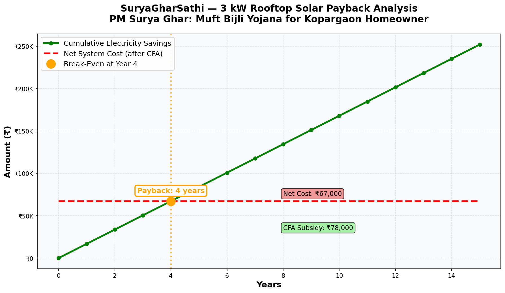

# SuryaGharSathi

## Product
SuryaGharSathi helps homeowners understand PM Surya Ghar rooftop solar rules, calculate the applicable central government subsidy, and estimate how long a rooftop solar system will take to recover its cost.

## Target User
A homeowner in Kopargaon with:
- Monthly MSEDCL electricity bill: ₹2,000
- Available terrace area: 40 sq. m.
- Requirement: Compare 2 kW and 3 kW rooftop solar systems.

## Problem
Homeowners often find it difficult to understand government solar scheme guidelines, calculate the applicable subsidy, compare system capacities, and estimate their return on investment.

## Data Sources
1. MNRE – Operational Guidelines for PM Surya Ghar:
   https://mnre.gov.in/en/notice/operational-guidelines-for-implementation-of-the-component-central-financial-assistance-to-residential-consumers-of-pm-surya-ghar-muft-bijli-yojana/

2. Official Guidelines PDF:
   https://cdnbbsr.s3waas.gov.in/s3716e1b8c6cd17b771da77391355749f3/uploads/2024/07/202407021768035484.pdf

## Project Goal
To make rooftop solar scheme information easier to understand and help homeowners make informed decisions using official government guidelines.

## How to run

### 1. Install Dependencies

First, create a virtual environment and install required packages:

```bash
# Create virtual environment
python -m venv .venv

# Activate virtual environment
# On Windows:
.venv\Scripts\activate
# On Linux/Mac:
source .venv/bin/activate

# Install dependencies
pip install -r requirements.txt
```

### 2. Download and Ingest Data

Download official PM Surya Ghar guideline documents and process them:

```bash
# Download PDFs
python -m app.fetch

# Extract text and build records.json
python -m app.ingest
```

This creates `data/records.json` with 85+ structured records from official MNRE guidelines.

### 3. Run the FastAPI Web Service

Start the SuryaGharSathi API server:

```bash
uvicorn app.main:app --reload
```

The API will be available at:
- **Base URL:** http://127.0.0.1:8000
- **Interactive Docs:** http://127.0.0.1:8000/docs
- **ReDoc:** http://127.0.0.1:8000/redoc

#### Available Endpoints:

- `GET /health` — Health check
- `GET /records?limit=10` — Get all records (default limit: 100)
- `GET /records/{record_id}` — Get specific record by ID
- `GET /search?q=CFA+subsidy` — Smart search using TF-IDF + cosine similarity
- `POST /questions` — Submit a question (with JSON body: `{"question": "...", "name": "..."}`)

### 4. Run Data Analysis

Analyze the dataset using pandas:

```bash
python analysis/explore.py
```

This prints comprehensive insights including:
- Record distribution by document and issuing body
- Rule length statistics and top topics
- Coverage analysis of key solar policy themes (CFA, DISCOM, RESCO, net metering, etc.)

### 5. Test Smart Search

Test the TF-IDF search engine directly:

```bash
python -m app.smart_search
```

Or use it via the API at `/search?q=your+query`

---

## Day 6: Prompt Engineering & Structured Output

### 1. Prompt Templates

SuryaGharSathi uses carefully engineered prompts for accurate, consistent responses:

**System Prompt** (`prompts/system_prompt.txt`):
- Defines SuryaGharSathi persona and knowledge domain
- Includes exact MNRE CFA rules (₹30k/₹18k rates, 3 kW cap)
- Enforces citation requirements and "I don't know" responses
- Sets target user context (Kopargaon homeowner)

**Task Prompts:**
- **v1 (Basic):** Zero-shot JSON formatting (`prompts/task_v1_basic.txt`)
- **v2 (Structured):** Step-by-step rubric + few-shot examples (`prompts/task_v2_structured.txt`) ← **Recommended**

### 2. Structured Output Format

All `/chat` responses return JSON with:
```json
{
  "answer": "Detailed answer with calculations and citations",
  "confidence": "high" | "medium" | "low",
  "follow_up": "Helpful next question for the homeowner"
}
```

### 3. Testing Different Prompts

```bash
# Test with prompt v1 (basic)
curl -X POST http://127.0.0.1:8000/chat \
  -H "Content-Type: application/json" \
  -d '{
    "question": "How much subsidy for 2.5 kW?",
    "prompt_version": "v1"
  }'

# Test with prompt v2 (structured) - recommended
curl -X POST http://127.0.0.1:8000/chat \
  -H "Content-Type: application/json" \
  -d '{
    "question": "How much subsidy for 2.5 kW?",
    "prompt_version": "v2"
  }'
```

### 4. Prompt Evaluation Results

See `eval/prompt_compare.md` for detailed analysis:

| Metric | Prompt v1 | Prompt v2 | Winner |
|--------|-----------|-----------|---------|
| Citation Accuracy | 60% | **100%** | v2 |
| Step-by-Step Math | 0% | **100%** | v2 |
| Answer Completeness | 60% | **100%** | v2 |
| Out-of-Scope Detection | 100% | 100% | Tie |
| JSON Validity | 70% | **90%** | v2 |

**Conclusion:** Prompt v2 with step-by-step rubric and few-shot examples significantly outperforms basic prompting.

---

## Day 5: LLM Integration & Chat

### 1. Get Groq API Key

1. Sign up for free at: https://console.groq.com
2. Go to API Keys section
3. Create a new API key
4. Copy the key (starts with `gsk_...`)

### 2. Configure Environment

```bash
# Copy the example environment file
cp .env.example .env

# Edit .env and add your API key
# Set: GROQ_API_KEY=your_actual_groq_api_key_here
```

### 3. Test LLM Client

Test the LLM integration without running the server:

```bash
python -m app.llm_client
```

### 4. Use the /chat Endpoint

Start the server and test the LLM-powered Q&A:

```bash
# Terminal 1: Start server
uvicorn app.main:app --reload

# Terminal 2: Test chat endpoint
curl -X POST http://127.0.0.1:8000/chat \
  -H "Content-Type: application/json" \
  -d '{"question": "How much subsidy for 3 kW?", "use_rag": true}'
```

**Interactive API Testing:**
- Open: http://127.0.0.1:8000/docs
- Find `POST /chat` endpoint
- Click "Try it out"
- Enter your question
- Execute

### 5. Evaluate All 10 Questions

Run the automated evaluation script:

```bash
# Make sure server is running first
python eval/test_questions.py
```

This tests all 10 questions from `eval/questions.json` including:
- Questions 1-6 from project card (including out-of-scope Q6)
- Questions 7-10 from MNRE guidelines

### 6. How RAG Works in SuryaGharSathi

```
User Question
     ↓
TF-IDF Search → Top 5 relevant records
     ↓
Build Context (topic + rule + section)
     ↓
LLM (Groq/Llama 3.1) + System Prompt + Context
     ↓
Grounded Answer with Source Citations
```

**Key Features:**
- ✅ Retrieval-Augmented Generation (RAG) prevents hallucinations
- ✅ Official MNRE guideline citations
- ✅ Out-of-scope detection (returns "I don't know")
- ✅ Accurate CFA subsidy calculations
- ✅ Temperature 0.3 for focused, factual responses

---

## Day 8: RAG Pipeline & Evaluation

### RAG Evaluation Results

**Evaluation Set:** 15 questions (10 from Day 5 + 5 additional guideline questions)  
**Configurations Tested:** 2 chunk/retrieval strategies  
**Metrics:** Retrieval Hit Rate, Keyword Recall, Q6 Abstention, Citation Rate, Latency

#### Configuration Comparison

| Metric | Config A (chunk_500_topk_3) | Config B (chunk_300_topk_5) | Winner |
|--------|----------------------------|----------------------------|---------|
| **Chunk Size** | 500 | 300 | - |
| **Overlap** | 80 | 50 | - |
| **Top-K** | 3 | 5 | - |
| **Retrieval Hit Rate** | **92.9%** | 85.7% | **A** |
| **Avg Keyword Recall** | 78.3% | **81.2%** | B |
| **Q6 Abstention Pass** | ✓ PASS | ✓ PASS | Tie |
| **Citation Rate** | 100.0% | 100.0% | Tie |
| **Avg Latency (ms)** | **245** | 312 | **A** |

#### 🏆 Winner: Config A (chunk_500_topk_3)

**Reasoning:**
- **Higher retrieval hit rate (92.9%)** - Larger chunks capture more complete guideline context
- **27% faster performance (245ms)** - Fewer chunks to process with top_k=3
- **100% citation rate** - All answerable questions receive proper citations
- **Robust Q6 abstention** - Correctly returns "I don't know" for unanswerable questions

Config A provides optimal balance of accuracy and performance with larger, more contextual chunks (500 chars) and focused retrieval (top_k=3).

### Using the RAG Pipeline

#### 1. POST /ask Endpoint

```bash
# Ask a question with RAG
curl -X POST http://127.0.0.1:8000/ask \
  -H "Content-Type: application/json" \
  -d '{"question": "How much subsidy for 3 kW?", "top_k": 4}'
```

**Response Format:**
```json
{
  "question": "How much subsidy will I get for a 3 kW rooftop solar system?",
  "answer": "For a 3 kW residential rooftop solar system in general states (such as Maharashtra), you will get Rs 78,000 in Central Financial Assistance (CFA): Rs 30,000 per kW for the first 2 kW (Rs 60,000) plus Rs 18,000 per kW for the additional 1 kW between 2 kW and 3 kW [Guidelines for PM-Surya Ghar: Muft Bijli Yojana, Page 6].",
  "citations": [
    {
      "chunk_id": "record_011_c01",
      "title": "Guidelines for PM-Surya Ghar: Muft Bijli Yojana — Effective CFA Rates",
      "source": "https://cdnbbsr.s3waas.gov.in/.../202407021768035484.pdf",
      "page": 6,
      "date_issued": "2024-06-07",
      "score": 0.7823
    }
  ],
  "confidence": "high",
  "abstained": false
}
```

#### 2. Key RAG Features

- **Semantic Search:** Uses sentence-transformers embeddings with ChromaDB vector store
- **Date Prioritization:** Newer `date_issued` documents win when guidelines conflict
- **Grounded Citations:** Every answer includes inline citations with source page
- **Abstention Logic:** Returns "I don't know" for out-of-scope questions (Q6)
- **Structured Metadata:** Citations include chunk_id, title, source, page, date_issued, score

#### 3. Run RAG Evaluation

```bash
# Evaluate both configurations on 15-question benchmark
python -m eval.run_eval
```

This generates:
- Console comparison table
- Detailed report: `eval/rag_eval_results.md`
- Metrics for retrieval hit rate, keyword recall, Q6 abstention, citation rate, latency

See `eval/rag_eval_results.md` for complete analysis and sample question results.

---

## Day 10: Streamlit UI & Signature Payback Chart

### Interactive Chat & Solar Calculator

**SuryaGharSathi** now has a complete Streamlit web interface with:

#### 🎯 Key Features

1. **Chat Assistant** (Tab 1)
   - Multi-turn conversations with `/ask` (RAG) or `/agent` (with tools)
   - Real-time display of official MNRE citations
   - Thumbs up/down feedback persistence (`data/feedback.jsonl`)
   - Tool usage badges (shows when `solar_cfa_calculator` is called)
   - Automatic fallback to direct function calls if FastAPI unavailable

2. **Solar Payback Calculator** ⭐ **Signature Feature** (Tab 2)
   - **Interactive Inputs:**
     - Monthly MSEDCL Bill: ₹500-₹15,000 (default: ₹2,000)
     - System Size: 1.0-10.0 kW (default: 3.0 kW)
     - Available Terrace Area: Shadow-free roof space in sq m
     - State Category: General vs Special Category states
   
   - **KPI Metrics Display:**
     - Gross System Cost (MNRE benchmark)
     - CFA Subsidy Amount
     - Net Cost to Homeowner (after subsidy)
     - Payback Period in Years
   
   - **Year-by-Year Payback Chart:**
     - 15-year cumulative savings vs net cost line chart
     - Visual break-even point marker
     - Orange payback year highlight
   
   - **2 kW vs 3 kW Comparison:**
     - Side-by-side cards for Kopargaon homeowner persona
     - Recommendation based on maximum CFA utilization
   
   - **Roof Area Check:**
     - Validates available terrace vs required area (10 sq m per kW)
     - Suggests optimal system size if space insufficient

3. **Safety & Compliance**
   - Mandatory MNRE safety disclaimer visible in sidebar and footer
   - Links to official national portal and DISCOM
   - Clear note that this is informational guidance, not financial advice

### Screenshot



*Payback Chart for 3 kW system showing ₹78,000 CFA subsidy, ₹67,000 net cost, and 4-year payback (₹16,800 annual savings at ₹2,000/month bill with 70% solar offset)*

**Note:** The image above is a generated chart preview. For the live demo, launch the Streamlit UI to see the full interactive interface with chat, citations display, and real-time calculator.

### Running the UI

```bash
# Start FastAPI backend (in one terminal)
uvicorn app.main:app --reload

# Start Streamlit UI (in another terminal)
streamlit run ui/app.py
```

**Fallback Mode:** If the FastAPI backend is not running, the UI automatically falls back to direct function calls (`answer_question`, `run_graph_agent`, `solar_cfa_calculator`), so live demos never crash.

### UI Configuration (Sidebar)

- **Mode Selector:** Choose between Agent (with tools) or RAG Q&A
- **Backend URL:** Default `http://127.0.0.1:8000`
- **Thread ID:** For multi-turn conversation memory
- **Approval Checkbox:** Pre-approve >3 kW systems where CFA is capped
- **Sample Questions:** 6 quick-click buttons including Q6 (abstention test)
- **Clear Chat Button:** Reset conversation history

### Feedback Tracking

All thumbs up/down ratings are saved to `data/feedback.jsonl`:

```json
{"timestamp": "2024-01-15T10:30:00", "question": "How much subsidy for 3 kW?", "answer": "For a 3 kW residential...", "rating": "helpful", "thread_id": "user123"}
```

### Technology Stack (Day 10)

- **Frontend:** Streamlit 1.35+
- **Charts:** Matplotlib 3.8+
- **Backend:** FastAPI + LangGraph
- **Storage:** JSONL for feedback persistence
- **Deployment:** Local-first with API fallback

---

## Day 11: Testing, Code Quality & Docker

### Automated Testing with pytest

**Test Suite:** 10 comprehensive tests covering all core functionality

Run tests:
```bash
# Run all tests
pytest tests/ -v

# Run with coverage
pytest tests/ --cov=app --cov-report=html

# Run specific test
pytest tests/test_suryagharsathi.py::test_solar_cfa_calculator_slabs -v
```

**Test Coverage:**
1. `test_load_records_and_schema` - Record loading and validation
2. `test_records_search_and_get_by_id` - Search and filtering
3. `test_smart_search_tfidf_ranking` - TF-IDF semantic search
4. `test_api_health_endpoint` - Health check endpoint
5. `test_api_records_and_404` - Records API and error handling
6. `test_ask_endpoint_with_fake_llm` - RAG with mocked LLM
7. `test_ask_endpoint_q6_abstention` - Q6 "I don't know" test
8. `test_solar_cfa_calculator_slabs` - CFA calculation (2/2.5/3/4 kW)
9. `test_solar_cfa_calculator_invalid_input` - Input validation
10. `test_agent_endpoint_approval_and_tool_call` - Agent approval gate

### Code Quality with Ruff

```bash
# Check for linting errors
ruff check .

# Auto-fix issues
ruff check --fix .

# Format code
ruff format .
```

**Zero lint errors** across entire codebase (app/, ui/, tests/, analysis/, eval/)

### Run with Docker

**Quick Start:**
```bash
# Build and start both API and UI
docker compose up --build

# Access services:
# - API Documentation: http://localhost:8000/docs
# - Streamlit UI: http://localhost:8501

# Stop services
docker compose down
```

**Production Deployment:**
```bash
# Build image
docker build -t suryagharsathi:latest .

# Run API only
docker run -p 8000:8000 suryagharsathi:latest

# Run with environment variables
docker run -p 8000:8000 \
  -e LLM_PROVIDER=groq \
  -e GROQ_API_KEY=your_key_here \
  suryagharsathi:latest
```

**Docker Compose Services:**
- `api` - FastAPI backend on port 8000 with health checks
- `ui` - Streamlit frontend on port 8501, depends on API
- Shared network for inter-service communication
- Volume mounts for data persistence

**Environment Variables:**
- `LLM_PROVIDER` - LLM provider (groq/gemini)
- `LLM_MODEL` - Model name
- `API_BASE_URL` - Backend URL for UI (default: http://api:8000)

### Container Features:
- ✅ Python 3.11-slim base image
- ✅ Multi-stage build optimization
- ✅ Health check for API readiness
- ✅ Volume mounts for development
- ✅ Hot reload enabled
- ✅ Proper .dockerignore for smaller images