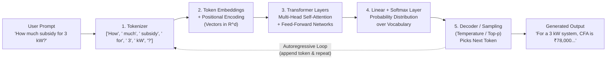

# How Large Language Models (LLMs) Work — In My Own Words

**Student:** Abhishek Sanjay Dighe (2124UMLM2056)  
**Project:** SuryaGharSathi (SJ-64) — PM Surya Ghar Rooftop Solar Assistant  

---

## 1. Overview: What is an LLM?

A **Large Language Model (LLM)** is a deep learning neural network (built on the **Transformer** architecture) trained on massive amounts of text to predict the **next token** in a sequence. Instead of looking up pre-written answers in a database, an LLM learns statistical patterns, grammar, facts, and reasoning structures from billions of sentences, and generates responses one token at a time based on the input prompt.

---

## 2. End-to-End LLM Pipeline Diagram

### Mermaid Flowchart



### ASCII Flow Diagram

```
┌─────────────────────────────────────────────────────────────────────┐
│  USER PROMPT: "How much subsidy will I get for a 3 kW solar system?"│
└────────────────────────────┬────────────────────────────────────────┘
                             │
                             ▼
┌─────────────────────────────────────────────────────────────────────┐
│  STEP 1: TOKENIZATION                                               │
│  ─────────────────────────────────────────────────────────────────  │
│  Input Text → Tokenizer (BPE/WordPiece)                             │
│  Breaks into sub-word tokens:                                       │
│  ["How", " much", " sub", "sidy", " will", " I", " get", " for",   │
│   " a", " 3", " k", "W", " solar", " system", "?"]                 │
│  Converts to Token IDs: [1482, 881, 1207, 4589, 690, 358, ...]     │
└────────────────────────────┬────────────────────────────────────────┘
                             │
                             ▼
┌─────────────────────────────────────────────────────────────────────┐
│  STEP 2: EMBEDDINGS + POSITIONAL ENCODING                           │
│  ─────────────────────────────────────────────────────────────────  │
│  Each Token ID → Embedding Vector (e.g., 768 dimensions)            │
│  Token 1482 ("How") → [0.23, -0.45, 0.12, ..., 0.67]               │
│  + Positional Encoding (sine/cosine waves) to preserve word order   │
│  Result: Input Matrix (seq_len × d_model)                           │
└────────────────────────────┬────────────────────────────────────────┘
                             │
                             ▼
┌─────────────────────────────────────────────────────────────────────┐
│  STEP 3: TRANSFORMER LAYERS (Self-Attention + Feed-Forward)         │
│  ─────────────────────────────────────────────────────────────────  │
│  Multi-Head Self-Attention:                                         │
│    • Query, Key, Value projections                                  │
│    • Attention scores: How much each token attends to others        │
│    • "subsidy" attends to "3 kW" and "solar system"                 │
│    • "3 kW" attends to "subsidy" and "get"                          │
│  Feed-Forward Network: Non-linear transformations per position      │
│  Repeated N times (e.g., 12, 24, or 96 layers for large models)    │
└────────────────────────────┬────────────────────────────────────────┘
                             │
                             ▼
┌─────────────────────────────────────────────────────────────────────┐
│  STEP 4: OUTPUT LAYER (Linear + Softmax)                            │
│  ─────────────────────────────────────────────────────────────────  │
│  Final hidden state → Linear projection to vocabulary size          │
│  Softmax → Probability distribution over all possible next tokens   │
│  Example probabilities:                                             │
│    "For"    → 0.32                                                  │
│    "A"      → 0.21                                                  │
│    "The"    → 0.15                                                  │
│    "In"     → 0.08                                                  │
│    ...other tokens... → 0.24                                        │
└────────────────────────────┬────────────────────────────────────────┘
                             │
                             ▼
┌─────────────────────────────────────────────────────────────────────┐
│  STEP 5: SAMPLING & DECODING                                        │
│  ─────────────────────────────────────────────────────────────────  │
│  Pick next token using sampling strategy:                           │
│    • Greedy: Pick highest probability token                         │
│    • Temperature sampling: Adjust randomness (low=focused)          │
│    • Top-p (nucleus): Sample from top cumulative probability        │
│  Selected token: "For" → Append to output                           │
│  AUTOREGRESSIVE LOOP: Feed back as input, repeat until <EOS>        │
└────────────────────────────┬────────────────────────────────────────┘
                             │
                             ▼
┌─────────────────────────────────────────────────────────────────────┐
│  GENERATED OUTPUT                                                   │
│  "For a 3 kW rooftop solar system under PM Surya Ghar, the Central │
│   Financial Assistance (CFA) is ₹78,000 for general category       │
│   states..."                                                        │
└─────────────────────────────────────────────────────────────────────┘
```

---

## 3. Detailed Step-by-Step Explanation

### Step 1: Tokenization

**What happens:** The raw text input is broken into smaller pieces called **tokens**. Tokens can be whole words, parts of words (sub-words), or even individual characters, depending on the tokenizer algorithm (e.g., Byte-Pair Encoding, WordPiece, SentencePiece).

**Example:**
- **Input:** `"How much subsidy will I get for a 3 kW solar system?"`
- **Tokens:** `["How", " much", " sub", "sidy", " will", " I", " get", " for", " a", " 3", " k", "W", " solar", " system", "?"]`
- **Token IDs:** `[1482, 881, 1207, 4589, 690, 358, 625, 329, 257, 513, 479, 54, 6591, 1080, 30]`

**Why sub-words?** This allows the model to handle rare words, typos, and new terms by breaking them into known parts. For example, "Kopargaon" might become `["Kop", "arg", "aon"]` if it's not in the vocabulary.

**For SuryaGharSathi:** When a homeowner in Kopargaon asks about their MSEDCL bill and terrace size, the tokenizer breaks technical terms like "kW", "CFA", "DISCOM", "net metering" into manageable pieces the model has seen during training.

---

### Step 2: Embeddings & Positional Encoding

**What happens:** Each token ID is converted into a high-dimensional **embedding vector** (typically 768, 1024, or 4096 dimensions). This vector represents the semantic meaning of the token in a continuous space where similar words are close together.

**Example:**
- Token ID `1207` ("sub") → embedding vector `[0.23, -0.45, 0.12, ..., 0.67]` (768 numbers)
- Token ID `4589` ("sidy") → embedding vector `[0.19, -0.42, 0.15, ..., 0.71]`

**Positional Encoding:** Since Transformers process all tokens in parallel (unlike RNNs), we add positional information using sine and cosine functions at different frequencies. This tells the model that "3" comes before "kW" in the sequence.

**Analogy:** Think of embeddings as GPS coordinates for words. "subsidy" and "grant" are close in meaning-space, while "subsidy" and "pizza" are far apart. Positional encoding adds a timestamp to each coordinate.

**For SuryaGharSathi:** The model learns that "CFA" (Central Financial Assistance), "subsidy", and "grant" have similar meanings, and that "3 kW" should be treated as a unit even though "3" and "kW" are separate tokens.

---

### Step 3: Transformer Layers & Multi-Head Self-Attention

**What happens:** The core of the LLM. Each Transformer layer contains:

1. **Multi-Head Self-Attention:** Computes relationships between all tokens in the input. For each token, the model asks "Which other tokens are relevant to understanding this one?"

   - **Query (Q), Key (K), Value (V) matrices:** Linear projections of the input embeddings
   - **Attention Score:** `Attention(Q, K, V) = softmax(QK^T / sqrt(d_k)) * V`
   - **Multiple heads:** Run attention computation in parallel with different learned projections, capturing different types of relationships (syntax, semantics, references)

2. **Feed-Forward Network:** Two-layer neural network applied independently to each position for non-linear transformations

3. **Residual Connections & Layer Normalization:** Help with training stability and gradient flow

**Example Attention Pattern:**
When processing "How much subsidy will I get for a 3 kW solar system?":
- The token "subsidy" strongly attends to "3 kW" (What is the subsidy for?)
- The token "kW" attends to "3" and "solar" (It's a capacity measurement)
- The token "get" attends to "I" and "subsidy" (Who receives what?)

**Why it works:** By attending to relevant context, the model builds rich representations that capture both local syntax and long-range dependencies. A 12-layer model applies this 12 times, progressively refining understanding.

**For SuryaGharSathi:** When asked "I want 4 kW on my house in Kopargaon. How much subsidy do I get?", the attention mechanism connects:
- "4 kW" → "subsidy" (capacity determines subsidy amount)
- "house" → "residential" (eligibility category)
- "Kopargaon" → "Maharashtra" → "MSEDCL" (location context)

However, the model may have learned **outdated subsidy rates** from old training data or might **hallucinate** intermediate calculations. This is why SuryaGharSathi uses RAG + tools.

---

### Step 4: Next-Token Probability Distribution (Softmax)

**What happens:** After all Transformer layers, the final hidden state passes through:
1. **Linear projection** to vocabulary size (e.g., 50,000 or 100,000 possible tokens)
2. **Softmax function** to convert raw scores (logits) into a probability distribution that sums to 1.0

**Example:**
After processing the prompt, the model predicts the next token:
```
Token           Probability
"For"           0.32
"A"             0.21
"The"           0.15
"In"            0.08
"Central"       0.05
... (other 50,000 tokens) ...
```

**For SuryaGharSathi:** The model might correctly predict "For a 3 kW system" but then **hallucinate** "the subsidy is ₹90,000" if it confused June 2024 MNRE guidelines with older schemes or mixed up 3 kW with 3.5 kW calculations.

---

### Step 5: Sampling & Decoding Strategies

**What happens:** The model picks the next token from the probability distribution using one of several strategies:

1. **Greedy Decoding:** Always pick the highest probability token
   - Fast but can be repetitive or get stuck in loops

2. **Temperature Sampling:** Divide logits by temperature T before softmax
   - `T < 1` (e.g., 0.7): More focused, deterministic (sharper distribution)
   - `T > 1` (e.g., 1.5): More random, creative (flatter distribution)
   - `T = 1`: No change

3. **Top-p (Nucleus) Sampling:** Sample from the smallest set of tokens whose cumulative probability exceeds p
   - `p = 0.9`: Consider only tokens that make up the top 90% of probability mass
   - Balances diversity and quality

4. **Top-k Sampling:** Consider only the k most likely tokens
   - `k = 50`: Pick from top 50 tokens

**Autoregressive Generation:** After picking a token, append it to the input sequence and repeat the entire process (Steps 1-5) until:
- A special `<EOS>` (end-of-sequence) token is generated
- Maximum length is reached
- A stop condition is met

**Example Output Sequence:**
```
1. "For"
2. "For a"
3. "For a 3"
4. "For a 3 k"
5. "For a 3 kW"
6. "For a 3 kW rooftop"
7. "For a 3 kW rooftop solar"
... (continue until complete answer)
```

**For SuryaGharSathi:** Even with good sampling, the LLM might generate plausible-sounding but **incorrect** answers like:
- "A 2.5 kW system gets ₹65,000 subsidy" (actual: ₹69,000)
- "The subsidy is released in 30 days" (actual: 90% after commissioning, 10% after performance report)
- Confusing RESCO model rules with standard residential CFA rules

---

## 4. Why LLMs Hallucinate & How SuryaGharSathi Solves It

### The Hallucination Problem

**LLMs hallucinate because:**

1. **Statistical Pattern Matching, Not Reasoning:** The model predicts tokens that sound plausible based on training data patterns, but doesn't verify facts or perform actual calculations.

2. **Training Data Cutoff:** If trained on data up to 2023, the model doesn't know June 2024 MNRE guidelines or December 2024 RESCO guidelines.

3. **Conflicting Information:** If the training data contains both old and new versions of rules, the model may blend them incorrectly.

4. **Calculation Errors:** LLMs are terrible at arithmetic. Asking "What is 60% of ₹50,000 for 2 kW plus 40% of ₹45,000 for 0.5 kW?" will likely produce wrong numbers.

5. **Overconfidence:** The model generates fluent, confident-sounding text even when making up facts.

**Real Examples from Solar Subsidy Domain:**
- **Hallucinated Subsidy:** "For a 2.7 kW system, you get ₹74,000 subsidy" (wrong calculation)
- **Outdated Information:** Citing subsidy rates from 2019 Phase-II instead of 2024 PM Surya Ghar
- **Confused Rules:** Mixing RESCO model payment security rules with direct consumer CFA disbursement
- **Made-up Eligibility:** Claiming industrial consumers can get residential CFA (false)

### How SuryaGharSathi Fixes This: RAG + Tools

**Solution 1: Retrieval-Augmented Generation (RAG)**

Instead of relying on memorized training data:
1. **Index Official Documents:** Store MNRE guidelines, DISCOM notices, RESCO rules in a vector database (using embeddings)
2. **Retrieve Relevant Context:** When user asks about subsidies, search the database for relevant sections
3. **Augment Prompt:** Pass retrieved text to the LLM as context
4. **Generate Grounded Answer:** LLM generates response based on authoritative source text, not memory

**SuryaGharSathi RAG Implementation:**
```python
# User query: "How much subsidy for 3 kW?"

# Step 1: Smart search (TF-IDF + cosine similarity)
relevant_records = smart_search(query="3 kW subsidy CFA", top_k=5)

# Step 2: Build context from retrieved records
context = "\n".join([
    f"Rule: {record.key_rule}\nSource: {record.source_section}"
    for record in relevant_records
])

# Step 3: Augment prompt
prompt = f"""Based on these official MNRE guidelines:

{context}

Question: {user_query}

Answer based only on the guidelines provided above."""

# Step 4: LLM generates grounded answer
response = llm.generate(prompt)
```

**Solution 2: Deterministic Tool for Calculations**

Instead of letting the LLM guess subsidy amounts:
```python
def calculate_cfa_subsidy(capacity_kw: float, state_category: str = "general") -> dict:
    """
    Deterministic calculator following MNRE guidelines exactly.
    """
    if state_category == "general":
        rate_first_2kw = 30000  # Rs 30,000 per kW
        rate_additional = 18000  # Rs 18,000 per kW
    else:  # special-category states
        rate_first_2kw = 33000
        rate_additional = 19800
    
    if capacity_kw <= 2.0:
        cfa = capacity_kw * rate_first_2kw
    elif capacity_kw <= 3.0:
        cfa = (2.0 * rate_first_2kw) + ((capacity_kw - 2.0) * rate_additional)
    else:
        # No additional CFA beyond 3 kW
        cfa = (2.0 * rate_first_2kw) + (1.0 * rate_additional)
    
    return {
        "capacity_kw": capacity_kw,
        "cfa_amount": cfa,
        "rate_first_2kw": rate_first_2kw,
        "rate_additional": rate_additional,
        "source": "MNRE Guidelines Section 5(h)"
    }

# Example usage
result = calculate_cfa_subsidy(3.0)
# Returns: {"capacity_kw": 3.0, "cfa_amount": 78000, ...}
```

**Benefits:**
- ✅ **100% Accurate Calculations:** No arithmetic errors
- ✅ **Up-to-date Rules:** Update function when guidelines change
- ✅ **Explainable:** Can show step-by-step breakdown
- ✅ **Fast:** No LLM inference needed for simple math

**Solution 3: Out-of-Scope Detection**

For questions the dataset cannot answer (e.g., "What will electricity rates be next year?"):
```python
# Check if query matches known topics using smart_search
results = smart_search(query, top_k=3)

if max_similarity_score < 0.15:  # Very low relevance
    return "I don't know. This question is outside the scope of PM Surya Ghar guidelines."
```

---

## 5. SuryaGharSathi Architecture: Putting It All Together

```
┌─────────────────────────────────────────────────────────────────┐
│  USER QUESTION                                                  │
│  "I want 4 kW on my house in Kopargaon. How much subsidy?"     │
└────────────────────────┬────────────────────────────────────────┘
                         │
                         ▼
┌─────────────────────────────────────────────────────────────────┐
│  RETRIEVAL (RAG) — app/smart_search.py                          │
│  • TF-IDF vectorization of query                                │
│  • Cosine similarity with 85 indexed MNRE guideline records     │
│  • Returns top-5 most relevant rules with scores                │
└────────────────────────┬────────────────────────────────────────┘
                         │
                         ▼
┌─────────────────────────────────────────────────────────────────┐
│  TOOL INVOCATION — solar_cfa_calculator()                       │
│  • Detects numeric query: "4 kW"                                │
│  • Calls deterministic calculator: calculate_cfa_subsidy(4.0)   │
│  • Returns: {"cfa_amount": 78000, "note": "Max 3 kW eligible"} │
└────────────────────────┬────────────────────────────────────────┘
                         │
                         ▼
┌─────────────────────────────────────────────────────────────────┐
│  CONTEXT ASSEMBLY                                               │
│  Combine:                                                       │
│  • Retrieved guideline text                                     │
│  • Calculator output                                            │
│  • User location context (Kopargaon → Maharashtra → MSEDCL)     │
└────────────────────────┬────────────────────────────────────────┘
                         │
                         ▼
┌─────────────────────────────────────────────────────────────────┐
│  LLM GENERATION (with Grounded Context)                         │
│  Prompt:                                                        │
│  """                                                            │
│  You are SuryaGharSathi, a PM Surya Ghar solar assistant.      │
│                                                                 │
│  Guidelines:                                                    │
│  [Retrieved rules about 4 kW systems, CFA caps, net metering]  │
│                                                                 │
│  Calculator Result:                                             │
│  For 4 kW system: CFA = ₹78,000 (capped at 3 kW)               │
│                                                                 │
│  Question: {user_question}                                      │
│                                                                 │
│  Answer based only on the guidelines and calculator above.      │
│  """                                                            │
└────────────────────────┬────────────────────────────────────────┘
                         │
                         ▼
┌─────────────────────────────────────────────────────────────────┐
│  GENERATED RESPONSE                                             │
│  "For a 4 kW rooftop solar system in Kopargaon, the Central    │
│   Financial Assistance (CFA) under PM Surya Ghar is ₹78,000.   │
│   This is because CFA is capped at 3 kW capacity (₹60,000 for  │
│   first 2 kW + ₹18,000 for additional 1 kW).                   │
│                                                                 │
│   Yes, you need net metering from MSEDCL. The DISCOM will      │
│   inspect and commission your system, and the net meter tracks  │
│   energy import/export.                                         │
│                                                                 │
│   Source: MNRE Guidelines Section 5(e) and 5(h)"               │
└─────────────────────────────────────────────────────────────────┘
```

---

## 6. Key Takeaways

1. **LLMs are probabilistic next-token predictors**, not databases or calculators
2. **Tokenization** breaks text into manageable pieces the model can process
3. **Embeddings** convert tokens into semantic vectors in high-dimensional space
4. **Transformer self-attention** allows the model to focus on relevant context
5. **Softmax + sampling** produces fluent, human-like text one token at a time
6. **Hallucinations happen** because LLMs optimize for plausibility, not accuracy
7. **RAG + Tools fix hallucinations** by grounding responses in verified data and using deterministic calculations

**For SuryaGharSathi:** By combining TF-IDF search over official MNRE guidelines (RAG) with a rule-based CFA calculator (Tool), we ensure homeowners in Kopargaon get accurate, up-to-date subsidy information—not hallucinated numbers from an LLM's outdated training data.

---

## 7. References & Further Reading

- **Attention Is All You Need** (Vaswani et al., 2017) — Original Transformer paper
- **BERT: Pre-training of Deep Bidirectional Transformers** (Devlin et al., 2018)
- **GPT-3: Language Models are Few-Shot Learners** (Brown et al., 2020)
- **Retrieval-Augmented Generation for Knowledge-Intensive NLP Tasks** (Lewis et al., 2020)
- **PM Surya Ghar: Muft Bijli Yojana Guidelines** (MNRE, June 2024)

---

**Document Version:** 1.0  
**Last Updated:** Day 5 — Checkpoint 1  
**Status:** Complete ✓
